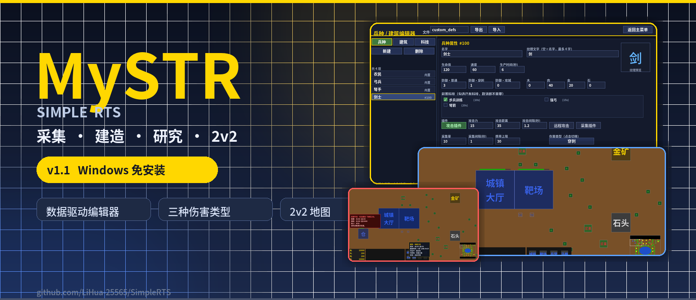
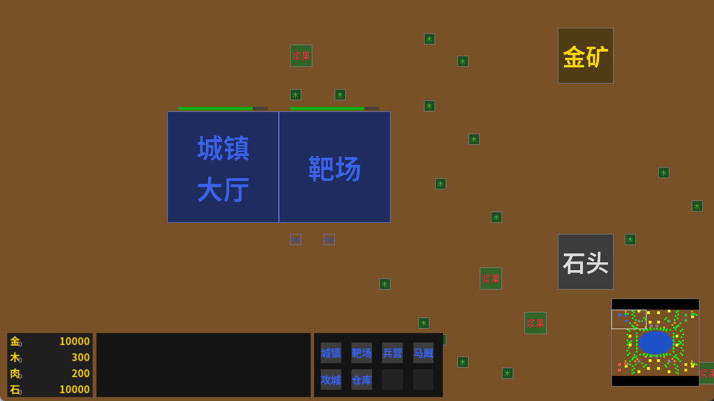
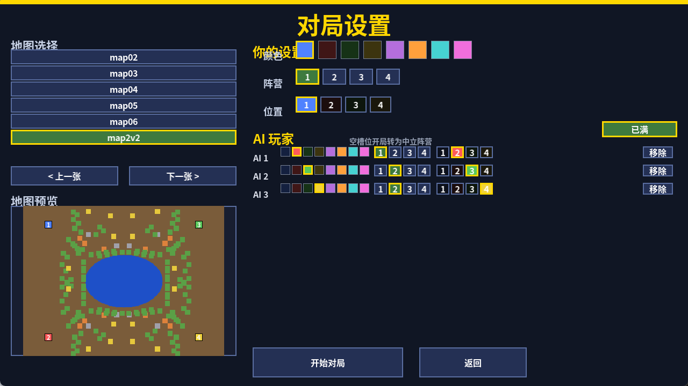
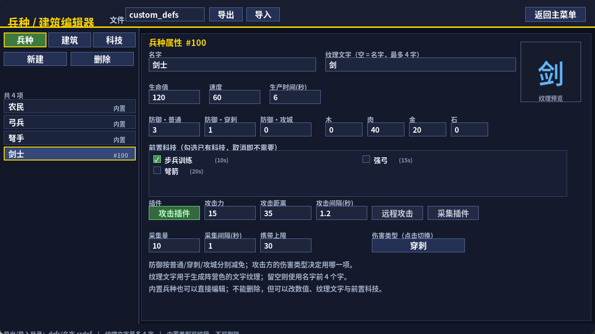
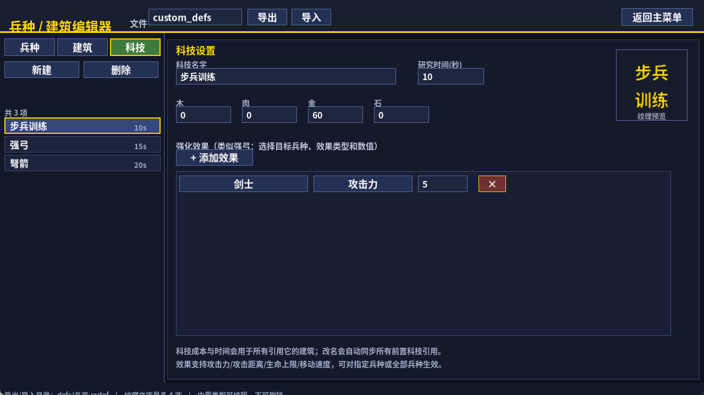
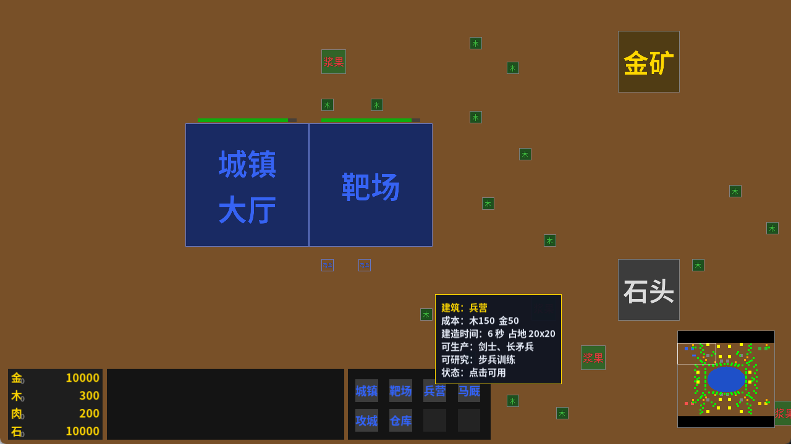
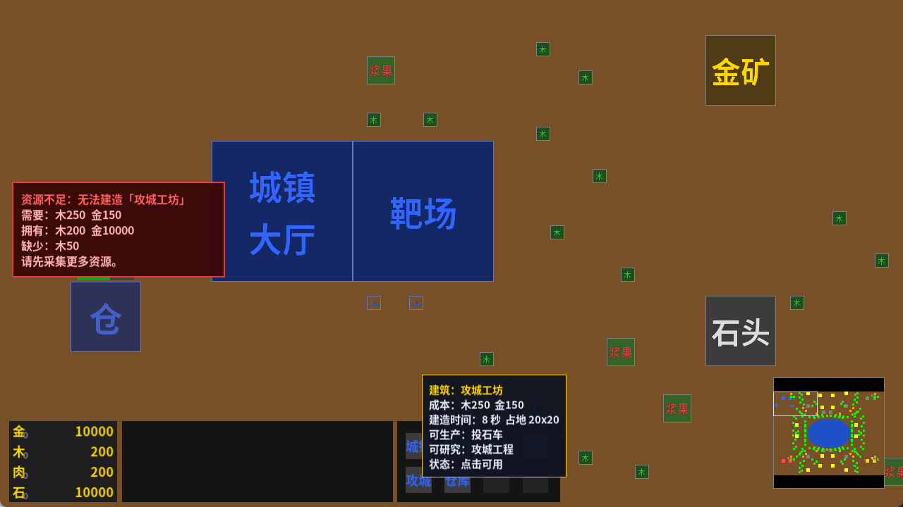

<div align="center">



# MySTR · SimpleRTS

**用 C++17 + SDL3 从零实现的 2D 即时战略游戏**

采集 · 建造 · 研究 · 编队 · 推进 · 2v2

[](https://github.com/LiHua-25565/SimpleRTS/releases/latest)
[](https://github.com/LiHua-25565/SimpleRTS/releases/latest)
[](#-快速开始)
[](#-从源码构建)
[](https://www.libsdl.org/)
[](https://github.com/LiHua-25565/SimpleRTS/stargazers)

[**下载 v1.1**](https://github.com/LiHua-25565/SimpleRTS/releases/latest) · [**更新日志**](CHANGELOG.md) · [**开发文档**](READ.txt) · [**提交问题**](https://github.com/LiHua-25565/SimpleRTS/issues)

</div>

---

## 这是什么？

MySTR 是一个**可以直接玩、也可以直接改**的 2D 即时战略游戏。

它没有使用现成引擎：ECS、地图流场寻路、RVO 局部避让、选择框、生产队列、AI、UI、数据定义与编辑器，全部用 C++17 和 SDL3 手写。你可以在游戏里采集资源、造建筑、研究科技、训练军队，也可以按 `F2` 打开编辑器，把兵种、建筑和科技改成自己想要的样子。

> **v1.1 主题：2v2 与数据驱动编辑器。**
> 新增 4 个兵种、4 个建筑、3 个科技、三种伤害类型、2v2 地图 `map2v2`，以及按钮悬停说明和资源不足红色提示。

---

## 截图

<table>
<tr>
<td width="50%">

<br />
<b>2v2 对局</b> · 四人基地、中央湖区、上下两路进攻
</td>
<td width="50%">

<br />
<b>map2v2</b> · 选图后自动配置人类 + AI 队友 vs 两个 AI
</td>
</tr>
<tr>
<td width="50%">

<br />
<b>兵种编辑器</b> · 可编辑内置兵种，也可新建自定义兵种
</td>
<td width="50%">

<br />
<b>科技编辑器</b> · 目标兵种 + 效果类型 + 数值，做出“强弓”式强化
</td>
</tr>
</table>

<p align="center">


<br />
<b>悬停查看成本/属性/科技效果</b> · <b>资源不足时左侧红色提示缺少多少</b>
</p>

---

## v1.1 新内容

### 数据驱动的兵种 / 建筑 / 科技

- 按 `F2` 进入编辑器。
- 内置兵种和建筑也能直接编辑，只是不能删除。
- 自定义类型 ID 从 `100` 开始，可以创建任意兵种、建筑和科技。
- 支持导出 / 导入 `.srdef`（UTF-8，版本 4）。
- 纹理不再依赖图片文件：每个定义可以设置 **纹理文字**（最多 4 字），用阵营色生成，不会分不清敌我。

### 三种有实际区别的伤害类型

| 类型 | 效果 |
|---|---|
| **普通** | 目标对应防御减免全额生效 |
| **穿刺** | 只受目标防御减免的 **50%**，克制高防单位 |
| **攻城** | 对建筑伤害 **×1.5** 且只受 50% 减免；对非建筑伤害 **×0.75** |

每类伤害都有独立的防御减免字段，编辑器里可以分别设置。

### 更多单位与建筑

- **剑士**：均衡前排，穿刺伤害
- **长矛兵**：高穿刺防御，适合对抗骑兵
- **骑兵**：高血量、高机动，普通伤害
- **投石车**：远程攻城，拆建筑主力，打单位效率低
- **兵营**：剑士 / 长矛兵 + 步兵训练
- **马厩**：骑兵 + 骑兵训练
- **攻城工坊**：投石车 + 攻城工程
- **仓库**：前线资源提交点

### 更适合 2v2 的 map2v2

- 320×240，四个基地，左右各两人同盟。
- 中央椭圆湖把战场分成上下两条进攻走廊。
- 湖岸树林、侧翼大金矿、中央资源点提供扩张和争夺目标。
- 选择 `map2v2` 时自动配置 **人类 + AI 队友 vs 两个 AI**。
- 2v2 开局 300 木 / 200 肉，每个 AI 也有起始靶场，开局更快进入交战。

### 更清晰的 UI 反馈

- 鼠标在生产/建造/研究按钮上停留 0.45 秒，显示成本、时间、属性、前置科技和科技效果。
- 点击按钮但资源不足时，屏幕左侧显示红色提示，列出 **需要 / 拥有 / 缺少** 的资源，5 秒后自动消失。

---

## 快速开始

### 方式一：下载 Release（推荐）

1. 打开 [**Releases**](https://github.com/LiHua-25565/SimpleRTS/releases/latest)。
2. 下载 `SimpleRTS-v1.1-win64.zip`。
3. 解压到任意目录（不要只把 exe 拖出来，`font/`、`maps/`、`defs/` 需要和 exe 放在一起）。
4. 双击 `SimpleRTS.exe`。

> Windows 10 / 11 64 位，无需安装。包内已带 SDL3 运行库、字体和 VC++ 运行库。
>
> 如果 SmartScreen 提示“Windows 已保护你的电脑”，这是未签名个人项目的常见提示；点击“更多信息 → 仍要运行”即可。

### 方式二：从源码构建

**环境要求**

- Windows 10 / 11 x64
- Visual Studio 2022 或 2026（安装“使用 C++ 的桌面开发”）
- CMake 3.21+

```powershell
# 使用你本机的 Visual Studio 生成器；2022 用 "Visual Studio 17 2022"
cmake -S . -B build -G "Visual Studio 18 2026" -A x64
cmake --build build --config Release
```

构建完成后运行 `build/Release/SimpleRTS.exe`。SDL3、SDL3_ttf、SDL3_image、SDL3_mixer 和 RVO2 已放在 `thirdparty/`，无需额外下载。

---

## 操作

| 操作 | 说明 |
|---|---|
| **左键单击 / 拖拽** | 选择单位、框选；点击空地移动编队 |
| **右键** | 移动、攻击、采集、向城镇中心/仓库提交资源 |
| **中键拖拽** | 平移摄像机 |
| **小地图点击** | 跳转视角 |
| **S** | 停止选中单位 |
| **Ctrl + A** | 全选己方单位 |
| **F2** | 打开兵种/建筑/科技编辑器 |
| **F11 / Alt + Enter** | 全屏切换 |
| **Esc** | 退出全屏 / 返回 |

> 生产、建造和研究按钮：鼠标停留查看说明；资源不足时点击会弹出红色提示。

---

## 游戏内容

### 兵种一览

| 兵种 | 定位 | HP | 攻击 | 伤害类型 | 射程 | 特点 |
|---|---|---:|---:|---|---:|---|
| 农民 | 经济 | 50 | 10 | 普通 | 近战 | 采集木/肉/金/石，建造 |
| 弓兵 | 远程 | 40 | 8 | 穿刺 | 200 | 基础远程单位 |
| 弩手 | 远程 | 45 | 12 | 穿刺 | 250 | 需研究「弩箭」 |
| 剑士 | 近战 | 120 | 15 | 穿刺 | 35 | 需「步兵训练」 |
| 长矛兵 | 近战 | 110 | 14 | 穿刺 | 40 | 高穿刺防御 |
| 骑兵 | 机动 | 160 | 18 | 普通 | 35 | 高速，适合侧翼 |
| 投石车 | 攻城 | 90 | 30 | 攻城 | 260 | 拆建筑，打单位效率低 |

### 建筑一览

| 建筑 | HP | 作用 |
|---|---:|---|
| 城镇大厅 | 1000 | 生产农民/弓兵，资源提交点 |
| 靶场 | 1200 | 生产弓兵/弩手，研究强弓/弩箭 |
| 兵营 | 900 | 生产剑士/长矛兵，研究步兵训练 |
| 马厩 | 900 | 生产骑兵，研究骑兵训练 |
| 攻城工坊 | 1000 | 生产投石车，研究攻城工程 |
| 仓库 | 800 | 前线资源提交点 |

### 科技

| 科技 | 效果 |
|---|---|
| 强弓 | 弓兵攻击距离 +50 |
| 弩箭 | 解锁弩手 |
| 步兵训练 | 剑士、长矛兵攻击力 +5 |
| 骑兵训练 | 骑兵攻击力 +6、生命上限 +20 |
| 攻城工程 | 投石车攻击力 +10、攻击距离 +30 |

科技效果不是写死的：在编辑器里可以把任意科技配成“某兵种/全部兵种 + 攻击力/攻击距离/生命上限/移动速度 + 数值”。研究完成后，已有单位立即生效，之后生产的单位也会自动继承。

---

## map2v2 布局与开局建议

```
玩家 1（左上）  玩家 3（右上）
        \  中央湖  /
玩家 2（左下）  玩家 4（右下）
```

- **同盟**：1 + 2 vs 3 + 4。
- **两条主路**：中央湖上方、下方；湖岸树林会逼迫部队走进预设走廊。
- **争夺点**：中央大金矿、侧翼大金矿、上下路石矿。
- **推荐开局**：
  1. 农民先采木，保证兵营/马厩的 150 木。
  2. 兵营出剑士 + 长矛兵，正面站住走廊。
  3. 马厩出骑兵，绕上/下路骚扰资源点。
  4. 中后期攻城工坊出投石车，配合步兵拆基地。
  5. AI 队友会在同阵营协同防守；也可以把队友改成其他阵营单刷。

---

## 数据驱动编辑器


按 `F2` 或主菜单「兵种建筑编辑」进入。

- **兵种**：名字、纹理文字、HP、三种防御、速度、攻击力、伤害类型、射程、攻击间隔、采集参数、成本、前置科技。
- **建筑**：名字、纹理文字、HP、三种防御、占地、建造时间、成本、前置科技、资源提交点、可生产单位、可研究科技。
- **科技**：名字、研究时间、四项成本、目标兵种、效果类型、数值。
- 生产列表和研究列表由定义自动生成，不需要改 C++ 数组。
- 导出 / 导入 `.srdef`；启动时自动加载 `defs/custom_defs.srdef`。
- 旧版本文件兼容：旧 `armor_value` 会转换成三种伤害的减免。

> 编辑器保存的定义会真正进入游戏：工厂、生产队列、AI 生产、地图编辑器、选中面板都读取同一份 `EntityCatalog`。

---

## 技术实现

```text
GameScene
 ├─ InputSystem / SelectionMgr       输入、选择、命令
 ├─ WorldEntityMgr + ECS             实体、组件、四叉树
 ├─ MoveSystem                       流场寻路 + RVO 局部避让
 ├─ AttackSystem / DamagePipeline    攻击、投射物、伤害类型
 ├─ HarvestSystem / ProductionSystem 采集、生产、研究
 ├─ AISystem                         经营、建造、出兵、协防
 ├─ UIMgr                           面板、按钮、悬停、资源提示
 └─ RenderMgr                        地图烘焙、UI、特效
```

- **ECS**：`GameObject` + `unordered_map<type_index, unique_ptr<Component>>`。
- **地图**：格子地图 + Dijkstra 流场，支持全局/局部流场。
- **移动**：流场寻路 + RVO2 局部避让，编队按类别排列。
- **数据**：`EntityCatalog` 统一管理内置 + 自定义定义，`.srdef` 文本格式。
- **UI**：立即模式 SDL 渲染；按钮悬停 0.45 秒显示说明，资源不足弹红色提示。
- **AI**：按阵营识别队友/敌人，经营、造靶场、训练、进攻、协防。

### 项目结构

```text
SimpleRTS/
├── SimpleRTS/                 # 游戏源码
│   ├── core/                  # ECS、相机、四叉树
│   ├── systems/               # 移动、攻击、采集、生产、AI
│   ├── scene/                 # 菜单、选择、对局、地图编辑器
│   ├── factories/             # 数据驱动实体工厂
│   ├── entity_defs.*          # 定义库 + .srdef 读写
│   ├── tech_effects.*         # 科技强化效果
│   ├── def_editor_scene.*     # F2 编辑器
│   ├── UI_mgr.*               # 游戏 UI
│   ├── defs/                  # 自定义兵种/建筑/科技
│   ├── maps/                  # .srmap 地图（含 map2v2）
│   └── font/                  # 思源黑体
├── thirdparty/                # SDL3 / SDL3_ttf / SDL3_image / SDL3_mixer / RVO2
├── docs/images/               # README 截图
├── CMakeLists.txt
├── README.md
├── CHANGELOG.md
└── READ.txt                   # 更详细的架构与开发文档
```

---

## Roadmap

- [x] ECS + 地图 + 框选 + 编队移动
- [x] 资源采集、建造、生产队列、科技
- [x] 流场寻路 + RVO 局部避让
- [x] 数据驱动兵种/建筑/科技编辑器
- [x] 三种有区别的伤害类型
- [x] 2v2 地图与阵营
- [ ] 更多地图与战役关卡
- [ ] 存档 / 读档
- [ ] 更多插件：治疗、驻防、陷阱、英雄技能
- [ ] Steam / itch.io 分发

---

## 更新日志

完整记录见 [CHANGELOG.md](CHANGELOG.md)。

### v1.1

- 新增 4 个兵种：剑士、长矛兵、骑兵、投石车。
- 新增 4 个建筑：兵营、马厩、攻城工坊、仓库。
- 新增 3 个科技：步兵训练、骑兵训练、攻城工程。
- 新增三种有实际区别的伤害类型：普通 / 穿刺 / 攻城。
- 新增 `map2v2`：4 基地、中央湖、上下两路、2v2 默认配置。
- 新增按钮悬停说明、资源不足红色提示。
- 内置单位/建筑全部可编辑；纹理改为可设置文字，使用阵营色。
- 修复建筑建造时间显示；AI 建造搜索范围扩大，2v2 每个 AI 获得起始靶场。

### v1.0

- 基础对局、资源采集、建造、生产、科技、AI、流场寻路与 RVO 避让。

---

## 致谢

- [SDL3](https://github.com/libsdl-org/SDL) / [SDL3_ttf](https://github.com/libsdl-org/SDL_ttf) / [SDL3_image](https://github.com/libsdl-org/SDL_image) / [SDL3_mixer](https://github.com/libsdl-org/SDL_mixer)
- [RVO2](https://github.com/snape/RVO2) 局部避让
- [Source Han Sans / 思源黑体](https://github.com/adobe-fonts/source-han-sans)（SIL Open Font License）
- 所有地图、单位、建筑、科技与 UI 均由本项目代码生成

---

<div align="center">

**如果这个项目对你有帮助，欢迎点一个 Star ⭐**

[报告问题](https://github.com/LiHua-25565/SimpleRTS/issues) · [查看 Release](https://github.com/LiHua-25565/SimpleRTS/releases)

</div>
